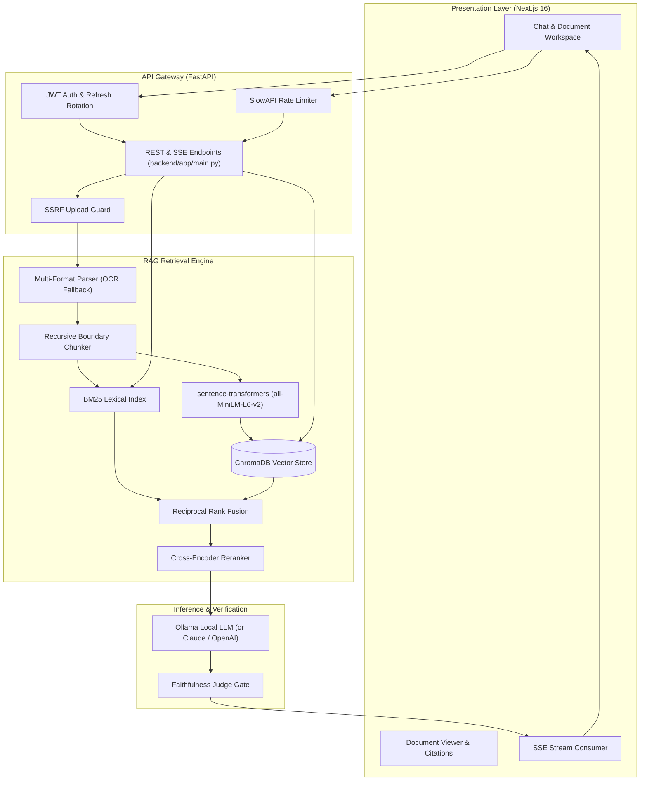

# Veridoc

[](https://github.com/themanoj-025/Veridoc/actions)
[](https://www.python.org/)
[](https://fastapi.tiangolo.com)
[](https://nextjs.org)
[](backend/tests/)
[](LICENSE)

> A local-first, zero-cloud Retrieval-Augmented Generation (RAG) platform that pairs hybrid retrieval (BM25 + dense search + Reciprocal Rank Fusion) and cross-encoder reranking with automated faithfulness verification and clickable document citations.

---

## Quick Facts

| Dimension | Details |
| --- | --- |
| **Core Architecture** | Decoupled Next.js 16 SPA + FastAPI REST service with Server-Sent Events (SSE) streaming |
| **Retrieval Engine** | Hybrid BM25 lexical search + 384-dim dense embeddings (`all-MiniLM-L6-v2`) via ChromaDB |
| **Rank Fusion & Reranking** | Reciprocal Rank Fusion (RRF) merged into Cross-Encoder (`ms-marco-MiniLM-L-6-v2`) top-5 selection |
| **Inference Runtime** | Local-first Ollama LLM execution with zero external cloud dependencies or API keys required |
| **Document Ingestion** | Multi-format parser (PDF, DOCX, TXT) with Tesseract OCR fallback for scanned documents |
| **Security Hardening** | 8/8 Red Team audit pass: SSRF protection, Fernet file encryption at rest, rate limits, RBAC |
| **Test Verification** | 322 collected pytest tests covering ingestion, security, retrieval, and API contracts |

---

## Table of Contents

- [Overview](#overview)
- [Key Features](#key-features)
- [System Architecture](#system-architecture)
- [Hybrid Retrieval Pipeline](#hybrid-retrieval-pipeline)
- [Security and Red Team Audit](#security-and-red-team-audit)
- [Repository Structure](#repository-structure)
- [Quick Start](#quick-start)
- [API Reference](#api-reference)
- [Configuration](#configuration)
- [Verification and Testing](#verification-and-testing)
- [Roadmap](#roadmap)
- [Contributing](#contributing)
- [License](#license)

---

## Overview

Most document Q&A tools generate persuasive answers that cannot be audited, frequently hallucinating assertions and lacking transparent attribution. **Veridoc** solves this through verifiable retrieval-augmented generation: every factual response is grounded in and cited directly to the exact source passage in your documents.

The platform executes entirely within your local environment. Document files are encrypted at rest with Fernet, vector embeddings are generated on-device, and local inference runs via Ollama—ensuring confidential files never leave the host infrastructure.

---

## Key Features

- **Hybrid Lexical & Semantic Retrieval**: Merges keyword-exact BM25 scoring with dense semantic similarity using Reciprocal Rank Fusion (RRF), eliminating keyword-miss blindspots.
- **Cross-Encoder Precision Reranking**: Evaluates top-20 retrieved candidates with `ms-marco-MiniLM-L-6-v2` to select the 5 most informative passages prior to generation.
- **Clickable Grounded Citations**: Answers return bracketed passage citations linking directly to exact character offsets and visual coordinates in the document viewer.
- **Faithfulness Verification Check**: Employs an automated validation pass that inspects generated output against retrieved context to block hallucinations before delivery.
- **Multi-Format Parsing & OCR**: Parses `.pdf`, `.docx`, and `.txt` files with automatic Tesseract OCR fallback for scanned page images.
- **Hardened Security Architecture**: Implements role-based access control (RBAC), per-user rate limiting via SlowAPI, SSRF IP blocking, and Fernet file encryption at rest.

---

## System Architecture



---

## Hybrid Retrieval Pipeline

1. **Boundary-Aware Chunking**: Documents are split using recursive separators (paragraphs, sentence endings, punctuation) with overlapping context windows to avoid mid-thought truncation.
2. **Dual-Index Search**:
   - **Lexical Stream**: BM25 scores exact vocabulary matches, part numbers, acronyms, and proper nouns.
   - **Dense Stream**: `all-MiniLM-L6-v2` generates 384-dimensional dense vectors to capture conceptual semantics.
3. **Reciprocal Rank Fusion (RRF)**: Merges candidates across streams using the ranking formula:
   $$RRF(d) = \sum_{m \in M} \frac{1}{k + r_m(d)}$$
4. **Cross-Encoder Reranking**: The top 20 fused candidates are scored jointly against the query using `ms-marco-MiniLM-L-6-v2`, distilling the list down to the 5 highest-relevance passages.
5. **Streaming Generation & Verification**: Synthesizes the response with bracketed passage citations and passes through a faithfulness verification gate before streaming to the client.

---

## Security and Red Team Audit

Veridoc completed an 8/8 red-team security verification suite:

- **SSRF Protection**: Upload URLs are validated against private IP ranges (`10.0.0.0/8`, `172.16.0.0/12`, `192.168.0.0/16`, `127.0.0.0/8`, link-local) before retrieval.
- **At-Rest Encryption**: User document files are encrypted with symmetric Fernet keys before writing to local disk volumes.
- **Authentication & RBAC**: Password hashing via bcrypt, signed JWT access tokens with strict refresh rotation, and Admin/User role separation on all endpoints.
- **Zero Exposed Secrets**: Codebase verified clear of hardcoded API tokens, keys, and private certificates.

---

## Repository Structure

```text
Veridoc/
├── backend/                   # FastAPI backend application
│   ├── alembic/               # PostgreSQL database migrations
│   ├── app/                   # Core application package
│   │   ├── api/               # Router endpoints (auth, chat, documents, admin)
│   │   ├── core/              # Dependencies, security, rate limiting, and config
│   │   ├── models/            # SQLAlchemy database entity models
│   │   ├── repositories/      # Database access layers
│   │   ├── schemas/           # Pydantic request and response schemas
│   │   ├── services/          # RAG pipeline, parsing, chunking, and retrieval
│   │   └── main.py            # FastAPI entry point
│   ├── tests/                 # Automated pytest suite (322 tests)
│   └── requirements.txt       # Backend dependencies manifest
├── frontend/                  # Next.js 16 web application
│   ├── app/                   # App Router pages and layout hierarchy
│   ├── components/            # Document viewer, citation popovers, chat UI
│   └── package.json           # Frontend dependencies (Next 16, React 18, Tailwind)
├── eval/                      # Standalone RAG evaluation harness
├── scripts/                   # Load testing, benchmark, and red-team scripts
├── docker-compose.yml         # Full local orchestration
└── Dockerfile                 # Multi-stage production container build
```

---

## Quick Start

### Prerequisites

- Python 3.12+
- Node.js 20+ and npm
- Ollama installed locally (for offline LLM inference)

### Automated Docker Deployment

Launch the complete self-hosted environment with Docker Compose:

```bash
# Clone the repository
git clone https://github.com/themanoj-025/Veridoc.git
cd Veridoc

# Configure environment variables
cp .env.example .env

# Build and start all services
docker compose up --build
```

Access the web interface at `http://localhost:3000`.

### Manual Local Development

```bash
# 1. Backend setup
python -m venv .venv

# On Linux/macOS:
source .venv/bin/activate
# On Windows:
.venv\Scripts\Activate.ps1

# Install backend dependencies and editable package
pip install -r backend/requirements.txt --index-strategy unsafe-best-match
pip install -e .

# Run database migrations
cd backend && alembic upgrade head && cd ..

# Start FastAPI server (available at http://localhost:8000)
uvicorn backend.app.main:app --reload --port 8000

# 2. Frontend setup (in a separate terminal)
cd frontend
npm install
npm run dev
```

---

## API Reference

The FastAPI service exposes REST and Server-Sent Events (SSE) endpoints under `/api/v1`.

### Endpoints

| Method | Endpoint | Description | Auth Required |
| --- | --- | --- | --- |
| `POST` | `/api/v1/auth/register` | Register new user account | No |
| `POST` | `/api/v1/auth/login` | Authenticate and obtain JWT access token | No |
| `POST` | `/api/v1/auth/refresh` | Rotate and refresh access token | Refresh Token |
| `POST` | `/api/v1/documents/upload` | Upload `.pdf`, `.docx`, or `.txt` file | Bearer Token |
| `GET` | `/api/v1/documents/` | List uploaded user documents | Bearer Token |
| `DELETE` | `/api/v1/documents/{id}` | Delete document and vector index | Bearer Token |
| `POST` | `/api/v1/chat/stream` | Stream grounded answer via SSE | Bearer Token |
| `GET` | `/api/v1/health` | Comprehensive dependency health probe | No |

### Sample Request: Streaming Chat

```bash
curl -X POST "http://localhost:8000/api/v1/chat/stream" \
  -H "Authorization: Bearer <YOUR_ACCESS_TOKEN>" \
  -H "Content-Type: application/json" \
  -d '{
    "query": "What are the standard payment terms outlined in section 4?",
    "document_ids": ["doc_4a7b8c"]
  }'
```

---

## Configuration

Settings are managed via environment variables or a local `.env` file (copied from `.env.example`).

| Variable | Description | Default | Required |
| --- | --- | --- | --- |
| `JWT_SECRET` | Secret key used for signing JWT authentication tokens | *None* | Yes |
| `FILE_ENCRYPTION_KEY` | 32-byte url-safe base64 key for Fernet file encryption | *None* | Yes |
| `DATABASE_URL` | PostgreSQL connection string | `postgresql+asyncpg://...` | Yes |
| `REDIS_URL` | Redis connection URL for background jobs and rate limits | `redis://localhost:6379/0` | Yes |
| `OLLAMA_BASE_URL` | Base URL for local Ollama server | `http://localhost:11434` | No |
| `LLM_PROVIDER` | Active LLM inference driver (`ollama`, `claude`, `openai`) | `ollama` | No |
| `EMBEDDING_MODEL` | HuggingFace embedding checkpoint | `all-MiniLM-L6-v2` | No |

---

## Verification and Testing

Veridoc maintains an automated test suite executed via pytest.

```bash
# Run backend test suite
pytest backend/tests/ -v

# Run standalone RAG evaluation harness
python scripts/run_standalone_eval.py
```

- **Collected Tests**: 322 tests
- **Verification Suites**:
  - Boundary-aware recursive text chunking and overlap verification.
  - SSRF URL validation across private, loopback, and unresolvable hostnames.
  - Reciprocal Rank Fusion (RRF) mathematical tie-breaking.
  - File encryption at rest roundtrip integrity.
  - Anti-enumeration authentication error responses.

---

## Roadmap

- [x] Hybrid BM25 and dense embedding retrieval with RRF fusion
- [x] Cross-encoder reranking integration
- [x] Multi-format document parser with Tesseract OCR fallback
- [x] Automated faithfulness verification gate
- [x] 8/8 Red Team security audit hardening
- [x] Next.js 16 streaming chat interface with interactive citations
- [ ] Multi-tenant organization shared document workspaces
- [ ] GPU-accelerated local cross-encoder batching
- [ ] Direct cloud storage connectors (S3, Google Drive, OneDrive)

---

## Contributing

Contributions are welcomed. Please review [CONTRIBUTING.md](CONTRIBUTING.md) and [SECURITY.md](SECURITY.md) before submitting pull requests.

---

## License

This project is licensed under the MIT License — see the [LICENSE](LICENSE) file for complete details.
